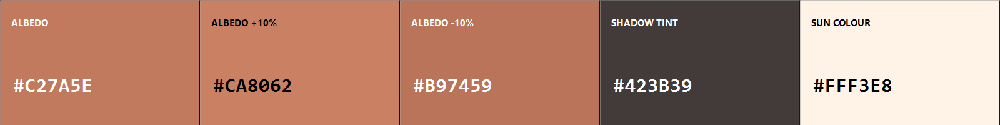

# Clay court palette -- measured from reference photography

Generated by `Tools/analyze_refs.ps1` from the 10 photographs in this folder.
Re-running the script reproduces this file byte for byte.

## Method

| Parameter | Value |
|---|---|
| Central crop | 50% of each axis (spec allows 40-60%) |
| Sampling | every Nth pixel in x and y, N = 4, via `LockBits` `Format32bppArgb` |
| Luminance window | 20..235 (Rec.709 on sRGB) -- rejects sky, people, crushed blacks |
| Colour histogram | 3D, 4 bits per channel = 16x16x16 = 4096 bins |
| Aggregation | arithmetic mean over images; `pooled_clay_mass` pools every accepted warm pixel |

## Per-image results

| File | Court mean | Mean L | Contrast (sd) | p10 L | p90 L | Warmth R-B | Accepted px | Dominant 1 | Dominant 2 | Dominant 3 |
|---|---|---|---|---|---|---|---|---|---|---|
| ref_01.jpg | #A67E73 | 133.9 | 41.0 | 69.4 | 177.6 | 51.4 | 218,397 | #C88878 | #D89888 | #B87868 |
| ref_02.jpg | #A18276 | 135.8 | 51.0 | 59.9 | 200.9 | 42.1 | 235,451 | #B85838 | #C86848 | #C86838 |
| ref_03.jpg | #775647 | 91.8 | 43.7 | 34.0 | 143.2 | 47.7 | 239,141 | #B85838 | #181818 | #282828 |
| ref_04.jpg | #816D67 | 112.8 | 46.6 | 49.6 | 180.6 | 25.8 | 186,340 | #A86848 | #B8B8B8 | #A8A8A8 |
| ref_05.jpg | #92816A | 130.6 | 56.2 | 42.1 | 195.0 | 40.2 | 127,915 | #98A8B8 | #A8B8C8 | #D88858 |
| ref_06.jpg | #BB968B | 157.3 | 39.4 | 96.9 | 191.2 | 48.3 | 174,914 | #E8A898 | #D89888 | #E8B8A8 |
| ref_07.jpg | #CB9188 | 156.3 | 38.6 | 104.7 | 200.9 | 66.4 | 234,757 | #D89888 | #C88878 | #D89898 |
| ref_08.jpg | #AD7158 | 123.9 | 52.2 | 69.6 | 207.9 | 85.4 | 293,016 | #984828 | #883828 | #983828 |
| ref_09.jpg | #8F6955 | 111.3 | 48.7 | 37.3 | 181.8 | 57.3 | 24,720 | #B86848 | #B86838 | #C86848 |
| ref_10.jpg | #835D50 | 100.1 | 51.4 | 38.4 | 183.9 | 50.8 | 238,621 | #C85828 | #B84818 | #C85818 |

### Dominant colours per image (top 5 of 4096 bins)

- **ref_01.jpg** -- #C88878 8.7%  #D89888 7.8%  #B87868 7.0%  #C88888 5.4%  #D89898 5.3%
- **ref_02.jpg** -- #B85838 8.3%  #C86848 5.9%  #C86838 4.6%  #B8C8D8 3.9%  #C8A888 2.4%
- **ref_03.jpg** -- #B85838 17.5%  #181818 6.2%  #282828 5.5%  #B86838 4.9%  #B86848 4.3%
- **ref_04.jpg** -- #A86848 10.2%  #B8B8B8 5.9%  #A8A8A8 4.5%  #A85848 4.0%  #985838 3.1%
- **ref_05.jpg** -- #98A8B8 4.3%  #A8B8C8 4.2%  #D88858 2.9%  #181808 2.3%  #E89868 1.9%
- **ref_06.jpg** -- #E8A898 17.0%  #D89888 13.5%  #E8B8A8 10.2%  #E8A8A8 5.6%  #D8A898 4.7%
- **ref_07.jpg** -- #D89888 7.1%  #C88878 6.1%  #D89898 5.4%  #D8A898 5.1%  #E8B8A8 4.4%
- **ref_08.jpg** -- #984828 6.1%  #883828 5.5%  #983828 4.9%  #E8E8E8 4.0%  #F87848 3.8%
- **ref_09.jpg** -- #B86848 14.7%  #B86838 9.3%  #C86848 6.6%  #A8B8C8 6.3%  #181818 4.8%
- **ref_10.jpg** -- #C85828 4.2%  #B84818 4.1%  #C85818 2.9%  #D86828 2.9%  #D86838 2.3%

## Aggregate (mean over 10 images)

| Metric | Value |
|---|---|
| Mean court sRGB | #9C7768  (R 155.7, G 118.6, B 104.2) |
| Mean luminance | 125.4 |
| Mean contrast (std dev) | 46.9 |
| Mean p10 luminance | 60.2 |
| Mean p90 luminance | 186.3 |
| Mean warmth (R-B) | 51.5 |
| Pooled clay mass | #BF785D over 976,366 warm pixels |

### Aggregate dominant colours

| Rank | Colour | Share of pooled pixels |
|---|---|---|
| 1 | #B85838 | 3.32% |
| 2 | #D89888 | 2.94% |
| 3 | #E8A898 | 2.38% |
| 4 | #C88878 | 1.93% |
| 5 | #E8B8A8 | 1.65% |

## Recommended values for UE 5.5

| Role | Hex | sRGB (0-1) | Linear (0-1) |
|---|---|---|---|
| Albedo (base colour) | #C27A5E | 0.761, 0.478, 0.369 | 0.539, 0.195, 0.112 |
| Albedo +10% lighter | #CA8062 | 0.792, 0.502, 0.384 | 0.591, 0.216, 0.122 |
| Albedo -10% darker | #B97459 | 0.725, 0.455, 0.349 | 0.485, 0.175, 0.100 |
| Shadow tint | #423B39 | 0.259, 0.231, 0.224 | 0.054, 0.044, 0.041 |
| Sun colour | #FFF3E8 | 1.000, 0.953, 0.910 | 1.000, 0.896, 0.807 |

### How each was derived

- **Albedo** -- pooled warm clay bins (R>G>B, R-B>=25, L 55..215), luminance normalised to 135.
  Normalising the luminance removes the per-photo exposure differences so the
  value is a material property, not a picture of a lit surface.
- **Albedo +/-10%** -- albedo x 1.10 in linear light / albedo x 0.90 in linear light.
- **Sun colour** -- mean of measured sunlit-clay pixels (>= p75 luminance, R>B), blended 30% to white, luminance 245.
- **Shadow tint** -- mean of measured shadowed-clay pixels (<= p25 luminance, R>B), desaturated 25% toward grey, luminance clamped p10 to 40..95.

